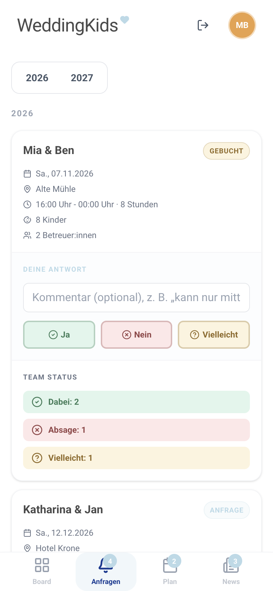
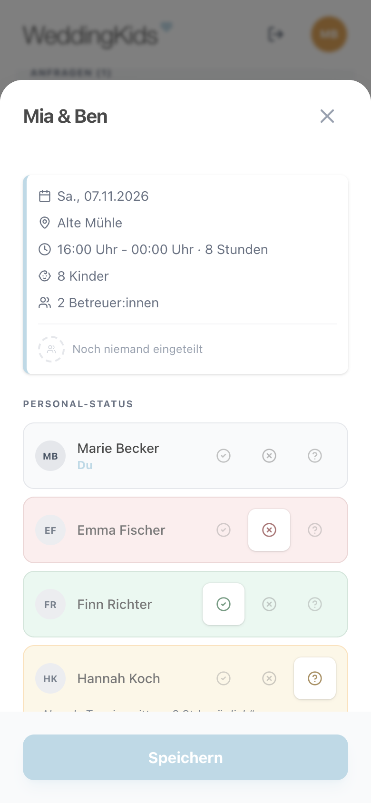
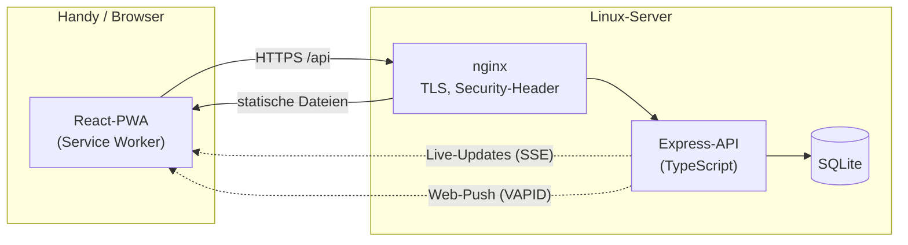

# WeddingKids PWA

[](https://github.com/Guppy997/weddingkids-pwa/actions/workflows/ci.yml)

Planungs-App für ein kleines Unternehmen, das **Kinderbetreuung auf Hochzeiten** anbietet. Das Team (2 Inhaberinnen, 14 Betreuer:innen) koordiniert darüber, wer bei welcher Hochzeit arbeitet: Anfragen kommen herein, alle melden ihre Verfügbarkeit, die Inhaberinnen teilen ein — und jede:r sieht die eigenen Einsätze im Kalender.

Die App läuft seit Mai 2026 produktiv und wird im Alltag genutzt. Sie ist als **Progressive Web App** auf dem Handy installierbar, aktualisiert sich live und verschickt Push-Benachrichtigungen.

<p align="center">
  
  
  
  
</p>
<p align="center"><sub>Anfragen beantworten · Hochzeit im Detail · Einteilung durch die Admins · Kalender — alle Daten in den Bildern sind erfunden</sub></p>

## Funktionen

**Für das Team**
- Offene Anfragen mit *Ja / Nein / Vielleicht* beantworten, optional mit Kommentar („abends Termin, mittags 3 Std. möglich“)
- Board mit allen Hochzeiten nach Status (Anfrage → Gebucht → Geplant)
- Kalender mit den eigenen Einsätzen und Team-Terminen (Liste oder Monatsansicht)
- News und Abstimmungen des Teams
- Profil, Passwort ändern, Datenexport und Konto-Löschung (DSGVO Art. 17/20)

**Für die Inhaberinnen (Admin)**
- Hochzeiten anlegen, bearbeiten und durch die Status führen; Rückmeldungen sehen und Personal fest einteilen
- Neue Mitarbeitende freigeben, Team verwalten, Passwörter zurücksetzen
- Aufgaben pro Hochzeit, Aktivitätsprotokoll, News und Abstimmungen

**Technisch**
- Echtzeit: Änderungen erscheinen sofort auf allen Geräten (Server-Sent Events)
- Web-Push bei neuen Anfragen, Einteilungen und Statusänderungen
- Offline-Seite und Update-Hinweis über einen eigenen Service Worker

## Architektur



| Bereich | Technik |
|---|---|
| Frontend | React 19, TypeScript, Vite, Tailwind CSS, Motion |
| Backend | Node.js, Express, TypeScript (tsx) |
| Datenbank | SQLite (better-sqlite3, WAL-Modus), Migrationen beim Start |
| Auth | JWT + bcrypt, Rollen Admin / Staff |
| Betrieb | nginx als Reverse-Proxy, systemd, Let's Encrypt, tägliche Backups |
| Tests | Vitest: API-Tests gegen echten Server-Prozess, Unit-Tests |

## Sicherheit

Die App verarbeitet personenbezogene Daten (Team, Hochzeitspaare, Kinderzahlen). Umgesetzt sind unter anderem:

- **Passwörter** nur als bcrypt-Hash (Kostenfaktor 12)
- **Account-Prüfung bei jeder Anfrage:** Gelöschte oder nicht freigegebene Accounts verlieren sofort den Zugriff; die Rolle kommt aus der Datenbank, nicht aus dem Token
- **Rechte serverseitig:** Mitarbeitende können per API nur ihre eigene Rückmeldung ändern — alles andere ist Admin-only, unabhängig davon, was die Oberfläche anzeigt
- **SQL** ausschließlich mit Platzhaltern (keine String-Verkettung von Eingaben)
- **Rate-Limits** für Login und schreibende Anfragen, Längen-Limits für Textfelder
- **HTTP-Header** über helmet und nginx: strenge Content-Security-Policy, HSTS, `X-Frame-Options: DENY`
- **Server:** Firewall, SSH nur per Schlüssel, fail2ban gegen Brute-Force

Die API-Tests in [`tests/`](tests/) prüfen genau diese Regeln (z. B. „gefälschter Token“, „gelöschter Account“, „Mitarbeitende ändern Hochzeitsdaten“).

## Projektstruktur

```
src/
├── server/                 Backend (Express)
│   ├── server.ts           Einstiegspunkt: DB öffnen, Server starten
│   ├── app.ts              Middleware-Kette und Routen
│   ├── config.ts           Konfiguration aus der .env
│   ├── database.ts         Schema und Migrationen
│   ├── routes/             ein Router pro Bereich (auth, weddings, staff, …)
│   ├── middleware/         Login-Prüfung, Rate-Limits, Eingabe-Limits
│   └── lib/                Push, Live-Updates, Aktivitätsprotokoll, …
├── components/             React-Komponenten
│   ├── admin/              Admin-Bereich (Tabs, Formulare, Karten)
│   └── calendar/           Kalender (Liste, Monatsraster, Termin-Formular)
├── context/AuthContext.tsx Login-Zustand
├── api.ts                  API-Client des Frontends
└── types.ts                gemeinsame Typen
tests/                      API- und Unit-Tests
scripts/seed-demo.ts        Demo-Datenbank mit erfundenen Daten
```

## Lokal starten

Voraussetzung: Node.js 22 oder neuer.

```bash
npm install
cp .env.example .env
npm run seed:demo      # legt data/demo.db mit erfundenen Daten an
npm run dev            # Backend auf :3001, Frontend auf :3000
```

Dann <http://localhost:3000> öffnen. Demo-Logins (Passwort jeweils `demo1234`):
`lena` (Admin) · `marie` (Mitarbeiterin)

Weitere Befehle:

| Befehl | Zweck |
|---|---|
| `npm test` | alle Tests |
| `npm run typecheck` | TypeScript-Prüfung (strict) |
| `npm run build` | Frontend nach `dist/` bauen |
| `npm start` | nur das Backend starten |

## Entwicklung

Konzipiert, umgesetzt und betrieben von Aaron Penalver Höfler — von den Anforderungen im Gespräch mit dem Team über Architektur und Sicherheitskonzept bis zum Betrieb des Servers. Entwickelt mit KI-Unterstützung (Claude Code).

Dieses Repository ist ein bereinigter Export des Produktivcodes: ohne echte Daten, Zugangsdaten und Server-Konfiguration. Die Entwicklungshistorie bleibt privat.

## Lizenz

Der Quellcode steht unter der [Apache License 2.0](LICENSE). Ausgenommen sind der Name „WeddingKids“, das Logo und die App-Icons. Sie sind Kennzeichen des Unternehmens und dürfen nicht weiterverwendet werden, Details in [`NOTICE`](NOTICE).
