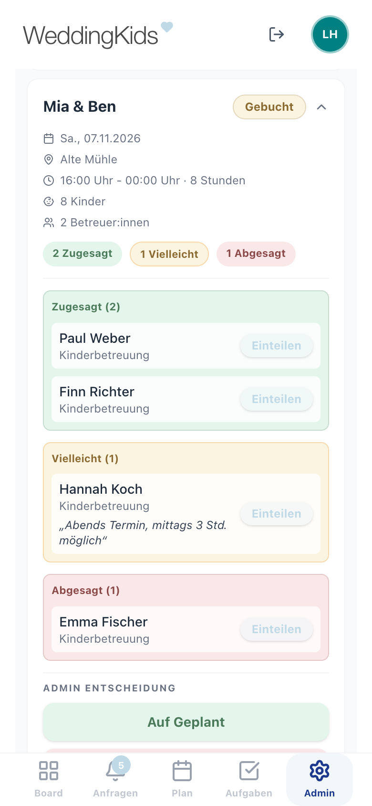
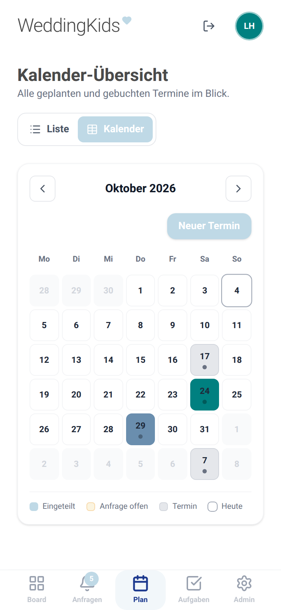
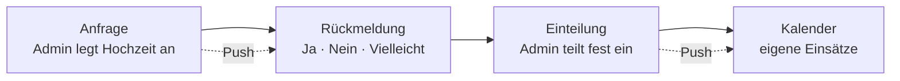
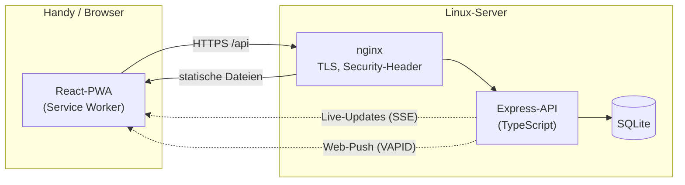

# WeddingKids PWA (Showcase)

[](https://github.com/Guppy997/weddingkids-showcase/actions/workflows/ci.yml)


> **In short (English):** A scheduling app for a small company that provides childcare at weddings. Requests come in, the team reports availability, the owners assign staff, and everyone sees their own shifts in a calendar, with live updates and web push. In production since May 2026. This repository is a cleaned-up export with made-up demo data; the interface is in German.

**WeddingKids PWA** ist die Planungs-App eines kleinen Unternehmens, das **Kinderbetreuung auf Hochzeiten** anbietet. Das Team koordiniert darüber, wer bei welcher Hochzeit arbeitet: Anfragen kommen herein, alle melden ihre Verfügbarkeit, die Inhaberinnen teilen ein, und alle sehen ihre eigenen Einsätze im Kalender. Die App ist auf dem Handy installierbar, aktualisiert sich live und verschickt Push-Benachrichtigungen.

> [!NOTE]
> **Showcase-Version:** bereinigter Export des Produktivcodes mit erfundenen Demo-Daten, ohne echte Daten, Zugangsdaten und Server-Konfiguration. Der Produktivcode und seine Entwicklungshistorie liegen in einem privaten Repository.

<table>
  <tr>
    <td align="center" width="25%"><br><sub>Anfragen beantworten</sub></td>
    <td align="center" width="25%"><br><sub>Hochzeit im Detail</sub></td>
    <td align="center" width="25%"><br><sub>Einteilung durch die Admins</sub></td>
    <td align="center" width="25%"><br><sub>Kalender</sub></td>
  </tr>
</table>

<sub>Screenshots mit Demo-Daten (siehe <a href="#demo-daten">Demo-Daten</a>), alle Namen und Orte sind erfunden. Aktuelle Version: 1.19.1.</sub>

## Inhalt

- [Im Einsatz](#im-einsatz)
- [So funktioniert's](#so-funktionierts)
- [Funktionen](#funktionen)
- [Architektur](#architektur)
- [Sicherheit und Datenschutz](#sicherheit-und-datenschutz)
- [Entwicklung](#entwicklung)
- [Releases und Versionen](#releases-und-versionen)
- [Projektstruktur](#projektstruktur)
- [API](#api)
- [Datenmodell](#datenmodell)
- [Grenzen und Ideen](#grenzen-und-ideen)
- [Entstehung](#entstehung)
- [Lizenz](#lizenz)

## Im Einsatz

Die App läuft seit Mai 2026 produktiv und wird im Alltag genutzt. Das Team aus 2 Inhaberinnen und 14 Betreuer:innen plant darüber alle Einsätze, von der ersten Anfrage bis zur festen Einteilung.

## So funktioniert's



1. **Anfrage:** Eine Inhaberin legt die Hochzeit mit Datum, Ort, Betreuungszeit und Kinderzahl an. Meist ist das ein einzelner Tag, bei Bedarf auch ein Zeitraum über mehrere Tage, zum Beispiel ein ganzes Hochzeitswochenende. Das Team bekommt eine Push-Benachrichtigung.
2. **Rückmeldung:** Alle melden mit *Ja*, *Nein* oder *Vielleicht*, ob sie können, auf Wunsch mit Kommentar.
3. **Einteilung:** Die Inhaberinnen sehen alle Rückmeldungen auf einen Blick, teilen fest ein und führen die Hochzeit von *Anfrage* über *Gebucht* bis *Geplant*. Eingeteilte sehen den Einsatz in ihrem Kalender und werden über Änderungen benachrichtigt.

## Funktionen

**Für das Team**
- **Anfragen** mit *Ja / Nein / Vielleicht* beantworten, optional mit Kommentar („abends Termin, mittags 3 Std. möglich“).
- **Board** mit allen Hochzeiten nach Status (Anfrage → Gebucht → Geplant).
- **Kalender** mit den eigenen Einsätzen und Team-Terminen, als Liste oder Monatsansicht. Mehrtägige Hochzeiten und Termine stehen an jedem ihrer Tage.
- **News und Abstimmungen** des Teams.
- **Profil:** Passwort ändern, Datenexport und Konto-Löschung (DSGVO Art. 17 und 20).
- **Neu in der App:** Versionsverlauf in Alltagssprache im Profil.

**Für die Inhaberinnen (Admin)**
- **Hochzeiten** anlegen, bearbeiten und durch die Status führen, Rückmeldungen sehen und Personal fest einteilen. Standard ist ein Tag; der Haken „Mehrere Tage“ neben dem Datum blendet ein Bis-Datum ein, vorbelegt mit dem Folgetag. Eine eingetragene Betreuungszeit lässt sich mit „Zeit entfernen“ wieder löschen.
- **Team:** neue Mitarbeitende freigeben, Team verwalten, Passwörter zurücksetzen.
- **Organisation:** Aufgaben pro Hochzeit, Aktivitätsprotokoll, News, Abstimmungen und Termine.
- **Aufräumen:** Abgesagte Hochzeiten verschwinden nach ihrem Datum automatisch, im Aktivitätsprotokoll bleibt ein Eintrag.

**Technisch**
- **Echtzeit:** Änderungen erscheinen sofort auf allen Geräten (Server-Sent Events).
- **Web-Push** bei neuen Anfragen, Einteilungen und Statusänderungen.
- **PWA:** installierbar, mit Offline-Seite und Update-Hinweis über einen eigenen Service Worker. Der Hinweis nennt, was in der neuen Version neu ist.
- **Aufräum-Job:** Der Server löscht beim Start und danach stündlich abgesagte Hochzeiten, deren Tag vorbei ist.

## Architektur



| Teil | Technik |
|---|---|
| Frontend | React 19, TypeScript, Vite, Tailwind CSS, Motion |
| Backend | Node.js, Express, TypeScript (tsx) |
| Datenbank | SQLite (better-sqlite3, WAL-Modus), Migrationen beim Start |
| Auth | JWT und bcrypt, Rollen Admin und Staff |
| Betrieb | nginx als Reverse-Proxy, systemd, Let's Encrypt, tägliche Backups |
| Tests und CI | Vitest: API-Tests gegen einen echten Server-Prozess und Unit-Tests; GitHub Actions mit Node 22 und 24, Renovate |

## Sicherheit und Datenschutz

Die App verarbeitet personenbezogene Daten (Team, Hochzeitspaare, Kinderzahlen). Umgesetzt sind unter anderem:

- **Passwörter** nur als bcrypt-Hash (Kostenfaktor 12).
- **Account-Prüfung bei jeder Anfrage:** Gelöschte oder nicht freigegebene Accounts verlieren sofort den Zugriff. Die Rolle kommt aus der Datenbank, nicht aus dem Token.
- **Login-Tokens** laufen nach 30 Tagen ab und verlängern sich bei jeder Nutzung der App. Eine Passwortänderung meldet alle anderen Geräte ab.
- **Live-Updates** öffnen die Verbindung mit einem Einmal-Ticket, das 60 Sekunden gilt. Der Login-Token steht nie in einer URL und landet so nicht in Server-Logs.
- **Push-Abos** nur für die Push-Dienste der Browser. Eine eingetragene Adresse kann den Server nicht zu Anfragen ins interne Netz bringen.
- **Rechte serverseitig:** Mitarbeitende können per API nur ihre eigene Rückmeldung ändern. Alles andere ist Admins vorbehalten, unabhängig davon, was die Oberfläche anzeigt.
- **Verlauf und Datenexport** hängen an der Account-ID, nicht am Anzeigenamen. Anzeigenamen sind im Team eindeutig, niemand kann unter dem Namen einer anderen Person auftreten.
- **Konten löschen** lässt News, Termine und Abstimmungen der Person stehen. Das eigene Konto geht nur über „Konto löschen“ mit Passwort, und der letzte Admin bleibt.
- **Profilbilder** nur als eingebettetes Bild (JPEG, PNG, WebP). Web-Adressen, die beim ganzen Team geladen würden, lehnt der Server ab.
- **Fehlerantworten** immer als JSON, ohne Stacktrace oder Serverpfade.
- **SQL** ausschließlich mit Platzhaltern, keine String-Verkettung von Eingaben.
- **Rate-Limits** für Login und schreibende Anfragen, Längen-Limits für Textfelder.
- **HTTP-Header** über helmet und nginx: strenge Content-Security-Policy, HSTS, `X-Frame-Options: DENY`.
- **Betroffenenrechte:** Alle können ihre Daten selbst exportieren und ihr Konto löschen. Nur der letzte Admin muss vorher einen anderen bestimmen.
- **Server:** Firewall, SSH nur per Schlüssel, fail2ban gegen Brute-Force.

Die API-Tests in [`tests/`](tests/) prüfen genau diese Regeln, zum Beispiel „Tokens mit falschem Secret“, „gelöschte Mitarbeitende verlieren sofort den Zugriff“, „Mitarbeitende können nicht für andere abstimmen“, „ein Stream-Ticket gilt nur einmal“ oder „Name einer anderen Person annehmen“. Ein eigener Test spielt Datenbank-Updates auf eine Datenbank im alten Stand ein und prüft, dass nichts verloren geht. Die CI bricht ab, sobald `npm audit` eine bekannte Lücke in den Server-Abhängigkeiten meldet.

Sicherheitslücken bitte vertraulich melden, wie in [`SECURITY.md`](SECURITY.md) beschrieben.

## Entwicklung

Voraussetzung: Node.js 22.12 oder neuer.

```bash
npm ci
cp .env.example .env   # die Werte reichen für den lokalen Start mit Demo-Daten
npm run seed:demo      # legt data/demo.db mit erfundenen Daten an
npm run dev            # Backend auf :3001, Frontend auf :3000
```

Dann <http://localhost:3000> öffnen. Demo-Logins mit dem Passwort `demo1234`: `lena` oder `sophie` (Admin), `marie` (Mitarbeiterin).

### Demo-Daten

`scripts/seed-demo.ts` legt ein erfundenes Team an (2 Admins, 6 Mitarbeitende und eine offene Registrierung), dazu Hochzeiten in allen vier Status (eine davon über ein ganzes Wochenende, die abgesagte liegt in der Zukunft, damit der Aufräum-Job sie nicht löscht), Rückmeldungen, News, Abstimmungen und Termine. Das Skript schreibt nur in eine neue Datei und bricht ab, wenn die Datenbank schon existiert. Eine echte Datenbank wird so nie verändert.

### Screenshots aktualisieren

Die Bilder in dieser README erzeugt `scripts/readme-screenshots.mjs` per headless Chrome, ohne zusätzliche Pakete. Die App muss mit den Demo-Daten laufen (`npm run dev`, siehe oben):

```bash
node scripts/readme-screenshots.mjs    # → docs/screenshots/
```

Andere Adressen oder Chrome-Pfad über `APP_URL`, `API_URL` bzw. `CHROME_PATH`. Zur Sicherheit läuft das Skript nur, wenn die App die Demo-Daten zeigt.

### Tests

```bash
npm test
```

121 Tests mit Vitest in elf Dateien:
- **API-Tests** gegen einen echten Server-Prozess mit eigener Test-Datenbank: Login, Token-Prüfung und -Ablauf, Passwortänderung, gelöschte und nicht freigegebene Accounts, Rechte von Admins und Mitarbeitenden, mehrtägige Hochzeiten, geschützte und versteckte Accounts, Aktivitätsprotokoll, eindeutige Anzeigenamen, Konten löschen, Profilbilder, Fehlerantworten, Live-Stream per Einmal-Ticket, Push-Abos.
- **Unit-Tests** für Betreuungszeiten, das Kalender-Raster mit mehrtägigen Zeiträumen, Datum und Zeitraum einer Hochzeit, Stream-Tickets, die Push-Benachrichtigungen nach Änderungen an einer Hochzeit, das automatische Löschen abgesagter Hochzeiten und die Datenbank-Migration aus dem Stand 1.19.0.

Die CI auf GitHub Actions prüft bei jedem Push und Pull Request Typen, Tests und Build mit Node 22 und 24.

### Befehle

| Befehl | Zweck |
|---|---|
| `npm run dev` | Backend und Frontend mit Hot Reload |
| `npm test` | alle Tests |
| `npm run typecheck` | TypeScript-Prüfung (strict) |
| `npm run build` | Frontend nach `dist/` bauen |
| `npm start` | nur das Backend starten |
| `npm run seed:demo` | Demo-Datenbank anlegen |

## Releases und Versionen

Dieser Showcase zeigt den Stand von Version **1.19.1**, gleichauf mit dem Produktivcode. Versionen folgen [Semantic Versioning](https://semver.org/lang/de/): neue Funktion = Minor (1.**19**.0), Fehlerbehebung = Patch (1.18.**1**).

Alle Änderungen stehen im [`CHANGELOG.md`](CHANGELOG.md). Zu jedem Release gehören:

1. die Version in `package.json` (erscheint in der App im Profil),
2. ein Eintrag in Alltagssprache in [`src/config/changelog.ts`](src/config/changelog.ts) (erscheint unter „Neu in der App“ und im Update-Hinweis),
3. ein Eintrag im `CHANGELOG.md`,
4. ein Git-Tag `vX.Y.Z` mit GitHub Release.

Die vollständige Entwicklungshistorie liegt im privaten Produktiv-Repository.

## Projektstruktur

```
.
├── .github/
│   └── workflows/ci.yml        Typecheck, Tests und Build bei jedem Push (Node 22 und 24)
├── src/
│   ├── server/                 Backend (Express)
│   │   ├── server.ts           Einstiegspunkt: DB öffnen, Server starten
│   │   ├── app.ts              Middleware-Kette und Routen
│   │   ├── config.ts           Konfiguration aus der .env
│   │   ├── database.ts         Schema und Migrationen
│   │   ├── routes/             Ein Router pro Bereich (auth, weddings, staff, …)
│   │   ├── middleware/         Login-Prüfung, Rate-Limits, Eingabe-Limits
│   │   └── lib/                Push, Live-Updates, Aktivitätsprotokoll, Aufräum-Job, …
│   ├── config/changelog.ts     Versionsverlauf für „Neu in der App“
│   ├── components/             React-Komponenten
│   │   ├── admin/              Admin-Bereich (Tabs, Formulare, Karten)
│   │   └── calendar/           Kalender (Liste, Monatsraster, Termin-Formular)
│   ├── context/AuthContext.tsx Login-Zustand
│   ├── api.ts                  API-Client des Frontends
│   └── types.ts                Gemeinsame Typen
├── tests/                      API- und Unit-Tests
├── scripts/
│   ├── seed-demo.ts            Demo-Datenbank mit erfundenen Daten
│   └── readme-screenshots.mjs  Screenshots für diese README
├── docs/screenshots/
├── .env.example                Alle Einstellungen mit Erklärung
├── renovate.json               Automatische Updates für npm und GitHub Actions (Renovate)
├── CHANGELOG.md                Alle Änderungen pro Version
├── SECURITY.md                 Sicherheitslücken vertraulich melden
├── LICENSE
├── NOTICE                      Ausnahmen von der Lizenz (Name, Logo, Icons)
└── TRADEMARKS.md               Was mit Name und Logo erlaubt ist und was nicht
```

## API

Alle Endpunkte sprechen JSON und brauchen einen Login-Token (`Authorization: Bearer …`), soweit nicht anders vermerkt. Spalte „Rolle“: *alle* heißt jedes freigegebene Konto, *Admin* nur die Inhaberinnen.

| Methode | Pfad | Zweck | Rolle |
|---|---|---|---|
| `POST` | `/api/auth/login` | Anmelden, liefert den Token | ohne Login |
| `POST` | `/api/auth/request-access` | Zugang beantragen, das Konto wartet auf Freigabe | ohne Login |
| `POST` | `/api/auth/register` | Konto direkt anlegen | Admin |
| `POST` | `/api/auth/verify` | Token prüfen, liefert das eigene Konto | alle |
| `PATCH` | `/api/auth/profile` | Eigenes Profil ändern; der Name muss im Team frei sein, Profilbild nur als eingebettetes Bild | alle |
| `POST` | `/api/auth/change-password` | Eigenes Passwort ändern | alle |
| `GET` | `/api/auth/export-data` | Eigene Daten exportieren (DSGVO Art. 20) | alle |
| `DELETE` | `/api/auth/delete-account` | Eigenes Konto löschen (DSGVO Art. 17) | alle |
| `GET` | `/api/weddings` | Alle Hochzeiten mit Rückmeldungen | alle |
| `POST` | `/api/weddings` | Hochzeit anlegen, optional mit `endDate` für mehrere Tage | Admin |
| `PATCH` | `/api/weddings/:id` | Hochzeit ändern; Mitarbeitende dürfen nur die eigene Rückmeldung setzen | alle (eingeschränkt) |
| `DELETE` | `/api/weddings/:id` | Hochzeit löschen | Admin |
| `GET` | `/api/weddings/:id/activity` | Aktivitätsprotokoll einer Hochzeit | Admin |
| `GET`, `POST` | `/api/weddings/:id/todos` | Aufgaben einer Hochzeit lesen und anlegen | Admin |
| `PATCH`, `DELETE` | `/api/todos/:todoId` | Aufgabe ändern oder löschen | Admin |
| `GET` | `/api/staff` | Team-Liste | alle |
| `GET` | `/api/staff/pending` | Offene Zugangsanfragen | Admin |
| `POST` | `/api/staff/:id/approve` | Zugang freigeben | Admin |
| `POST` | `/api/staff/:id/reset-password` | Passwort zurücksetzen | Admin |
| `DELETE` | `/api/staff/:id` | Mitarbeitende entfernen, nicht das eigene Konto | Admin |
| `GET` | `/api/notes` | News lesen | alle |
| `POST`, `DELETE` | `/api/notes`, `/api/notes/:id` | News anlegen oder löschen | Admin |
| `GET` | `/api/polls` | Abstimmungen lesen | alle |
| `POST`, `DELETE` | `/api/polls`, `/api/polls/:id` | Abstimmung anlegen oder löschen | Admin |
| `POST` | `/api/polls/:id/vote` | Abstimmen | alle |
| `GET` | `/api/events` | Termine; Mitarbeitende sehen nur öffentliche | alle |
| `POST`, `PATCH`, `DELETE` | `/api/events`, `/api/events/:id` | Termine anlegen, ändern, löschen | Admin |
| `GET` | `/api/admin/dashboard` | Kennzahlen: aktive Hochzeiten, Hochzeiten ohne Personal, offene Anfragen | Admin |
| `GET` | `/api/admin/activity` | Aktivitätsprotokoll gesamt | Admin |
| `POST` | `/api/stream/ticket` | Einmal-Ticket für die Live-Updates (60 Sekunden gültig) | alle |
| `GET` | `/api/stream?ticket=…` | Live-Updates (Server-Sent Events); Ticket statt Token in der URL, weil EventSource keine Header senden kann | ohne Login (Ticket) |
| `GET` | `/api/push/public-key` | Öffentlicher VAPID-Schlüssel | ohne Login |
| `POST` | `/api/push/subscribe`, `/api/push/unsubscribe` | Push für dieses Gerät an- oder abmelden | alle |
| `POST` | `/api/push/test` | Test-Benachrichtigung an die eigenen Geräte | alle |

## Datenmodell

| Tabelle | Wichtige Spalten |
|---|---|
| `users` | `username` (eindeutig), `name` (eindeutig unter aktiven Accounts), `password_hash`, `role` (`Admin`/`Staff`), `department`, `status` (`active`/`pending`), `password_changed_at` |
| `weddings` | `couple_names`, `date`, `end_date` (nur bei mehreren Tagen), `betreuungszeit`, `location`, `status` (`Anfrage`/`Gebucht`/`Geplant`/`Abgesagt`), `children_count`, `staff_needed`, `notes` |
| `assignments` | `wedding_id`, `staff_id`, `status` (`Ja`/`Nein`/`Vielleicht`/`Ausstehend`), `assigned` (fest eingeteilt), `comment`, eindeutig pro Hochzeit und Person |
| `todo_items` | `wedding_id`, `text`, `done`, `sort_order` |
| `activity_log` | `wedding_id`, `event_type`, `description`, `actor_id` (Account, entscheidet über Export und Sichtbarkeit), `actor_name` (nur Anzeige) |
| `notes` | News: `text`, `created_by_id` (leer, wenn das Konto gelöscht ist), `created_by_name` |
| `polls`, `poll_votes` | Frage; eine Stimme (`Ja`/`Nein`/`Vielleicht`) pro Person und Abstimmung |
| `events` | Termine: `title`, `date`, `end_date`, `start_time`, `end_time`, `description`, `color`, `public` |
| `push_subscriptions` | `user_id`, `endpoint` (eindeutig), Schlüssel des Browsers |

Gelöschte Hochzeiten und Konten nehmen ihre Rückmeldungen, Aufgaben und Push-Abos per `ON DELETE CASCADE` mit. News, Termine und Abstimmungen eines gelöschten Kontos bleiben stehen (`ON DELETE SET NULL`), der Name steht weiter in `created_by_name`. Abgesagte Hochzeiten löscht der Server automatisch, sobald ihr (letzter) Tag vorbei ist.

## Grenzen und Ideen

**Bekannte Grenzen**
- Showcase ohne Entwicklungshistorie und ohne Server-Konfiguration: nginx, systemd und Backups sind beschrieben, aber nicht enthalten.
- Für ein Unternehmen gebaut: ein Team, keine Mandanten.
- Oberfläche nur auf Deutsch.
- Ein Server-Prozess: Die Live-Updates (SSE) laufen im Speicher dieses Prozesses, mehrere Instanzen nebeneinander sind nicht vorgesehen.
- Automatisierte Tests decken API und einzelne Funktionen ab, noch nicht die Oberfläche.

**Ideen**
- Oberflächen-Tests für die wichtigsten Abläufe: Anfrage beantworten, einteilen, Kalender.

## Entstehung

Entwickelt mit KI-Unterstützung (Claude). Idee, Architektur, Anforderungen, Tests und Betrieb liegen bei mir; jede Änderung ist geprüft und versioniert. Die Anforderungen sind im Gespräch mit dem Team entstanden.

## Lizenz

Der Quellcode steht unter der [Apache License 2.0](LICENSE). Ausgenommen sind der Name „WeddingKids“, das Logo und die App-Icons. Sie sind Kennzeichen des Unternehmens WeddingKids und dürfen nicht für eigene Angebote verwendet werden. Was erlaubt ist und was nicht, steht in [`TRADEMARKS.md`](TRADEMARKS.md), die rechtliche Ausnahme in [`NOTICE`](NOTICE).
